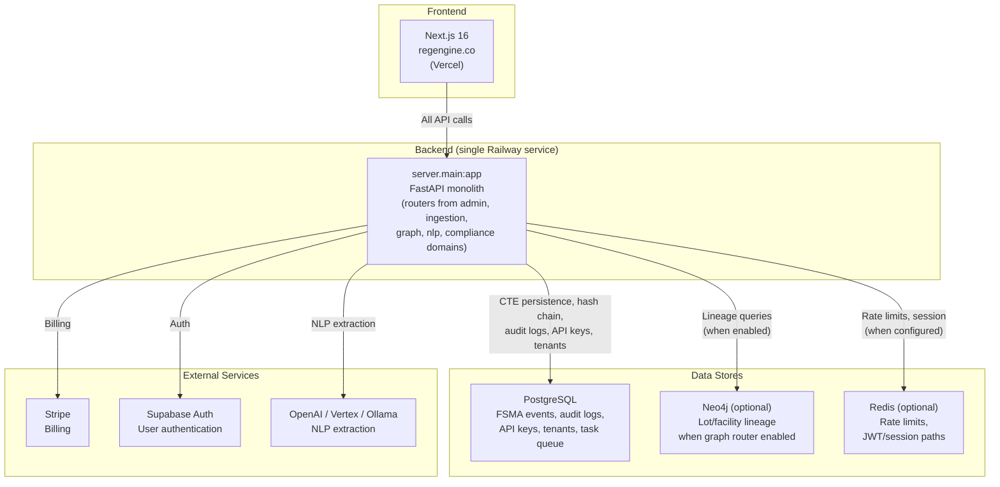

# RegEngine Architecture (FSMA-First)

Last verified: 2026-05-23

> **The deployed shape is a single consolidated FastAPI monolith.**
> The directory structure under `services/` preserves decomposition
> seams as code-organization boundaries only — they are not separate
> deploys. See [`CONSOLIDATION.md`](CONSOLIDATION.md) for the source
> of truth on what's actually deployed and why the legacy layout
> still exists.

## Purpose

This document describes the architecture actually implemented in this repository and used for the current FSMA-first product wedge. If a claim cannot be traced to a file, endpoint, migration, or test in this repository, it does not belong here.

## Product Scope

- Primary domain: FDA FSMA 204 traceability.
- Primary outcomes: CTE/KDE capture, lot traceability, and 24-hour FDA export readiness.
- Primary workflow: supplier onboarding → event ingestion → tamper-evident persistence → graph traversal → export.

## System Architecture Diagram



## Deployment Topology

- **Backend:** one Railway service that builds the repo-root [`Dockerfile`](../../Dockerfile) and starts `server.main:app`. Railway's native TLS + routing terminates the public domain — no separate gateway.
- **Frontend:** Next.js App Router app in `frontend/` deployed to Vercel (`regengine.co`) via its own workflow.
- **Database:** PostgreSQL via `DATABASE_URL` (production: Supabase Postgres 17).
- **Optional infra:** Neo4j, Redis, and Redpanda-compatible code paths exist in-tree but are not part of the default local dev stack (`docker-compose.dev.yml` starts only Postgres). Treat any in-tree reference to a 6-port topology as historical scaffolding unless you can trace it back to the current Dockerfile.

## Async / Event Backbone

- Background work uses PostgreSQL-backed task processing via [`server/workers/task_processor.py`](../../server/workers/task_processor.py) and [`services/shared/task_queue.py`](../../services/shared/task_queue.py).
- The Kafka/Redpanda consumer code in-tree pre-dates the consolidation decision (see [`alembic/versions/20260329_task_queue_v050.py`](../../alembic/versions/20260329_task_queue_v050.py)) and is not part of the current deploy contract.

## Router Surface

`server/main.py` mounts ~60 routers grouped into five domains:

| Domain | Source | Examples |
|---|---|---|
| Ingestion | `services/ingestion/app/` | webhook, CSV import, EDI, EPCIS, FDA export, supplier portal |
| Compliance control plane | `services/ingestion/app/` (canonical/rules/exceptions live here) | rules, exceptions, request workflow, identity, auditor review |
| Admin | `services/admin/app/` | tenants, users, auth, invites, MFA, audit logs, supplier onboarding |
| Graph | `services/graph/app/` | traceability + lineage (Neo4j-backed, mounted when enabled) |
| NLP | `services/nlp/app/` | document extraction (mounted when enabled) |

Routers can be turned off per-deploy via `DISABLED_ROUTERS`. Experimental routers (see `_EXPERIMENTAL_ROUTERS` in `server/main.py`) auto-disable in production unless `ENABLE_EXPERIMENTAL_ROUTERS=true`. The live surface is reported by `GET /api/v1/features`.

## Shared Bootstrap Pattern

Service-shaped subtrees still use the shared bootstrap from [`services/shared/paths.py`](../../services/shared/paths.py):

- `ensure_shared_importable()` adds project/service/shared paths for consistent imports across pytest, local dev, and the Docker build.
- The monolith entry calls this once during startup; per-service `main.py` files (e.g. `services/ingestion/main.py`) call it too when run standalone for local debugging.

## FSMA Data Flow (Implemented)

1. **Event ingest:** `POST /api/v1/webhooks/ingest` — [`services/ingestion/app/webhook_router_v2.py`](../../services/ingestion/app/webhook_router_v2.py)
2. **Persistence + integrity chain:** [`services/shared/cte_persistence/`](../../services/shared/cte_persistence/) persists events, KDEs, hash-chain links, and compliance alerts inside one transaction.
3. **Canonical normalization + rule evaluation:** runs inside the same savepoint as the primary write so a rule rejection (under `RULES_ENGINE_ENFORCE=cte_only|all`) rolls back the CTE write atomically. See [`services/shared/rules/enforcement.py`](../../services/shared/rules/enforcement.py).
4. **Graph sync:** ingestion publishes sync signals consumed by the graph routers under [`services/graph/app/`](../../services/graph/app/).
5. **FDA export + verification:** [`services/ingestion/app/fda_export/router.py`](../../services/ingestion/app/fda_export/router.py).

## Data Stores

- **PostgreSQL** — durable FSMA event persistence, hash-chained audit log, API keys, tenant metadata, task queue. Schema lives under [`alembic/versions/`](../../alembic/versions/).
- **Neo4j** — lot/facility/event lineage when the `graph` router is enabled. Optional in dev; required for graph-traversal endpoints in prod when the feature is mounted.
- **Redis** — rate limiting + session-adjacent paths when `REDIS_URL` is set. The app degrades cleanly when unset.

## Startup Drift Guards

`server/main.py` runs [`verify_orm_db_type_alignment`](../../services/shared/db_type_assertions.py) at startup against each ORM Base on the production hot path. Currently covered:

- [`services/admin/app/sqlalchemy_models.py`](../../services/admin/app/sqlalchemy_models.py) — admin schema (tenant/user/audit).
- [`services/shared/api_key_store.py`](../../services/shared/api_key_store.py) — `api_keys` table (auth surface).

Extending the check to additional Bases is a deliberate decision per the criteria documented in `server/main.py`. Drift on `tenant_id` UUID columns or `audit_logs` hash-chain columns fails startup; other drift logs a structured warning.

## Auth, Tenant Isolation, and Contracts

- **API key contract:** `X-RegEngine-API-Key` header. Hashed at rest with HMAC-SHA256 when `REGENGINE_API_KEY_HASH_PEPPER` is set, else legacy SHA-256.
- **Shared auth dependency:** [`services/shared/auth.py`](../../services/shared/auth.py) (`require_api_key`).
- **Tenant context middleware:** [`services/shared/middleware/`](../../services/shared/middleware/). Every request resolves a `TenantContext` from the authenticated principal before any handler sees it; legacy routers cannot use path/query/header tenant claims to pivot across tenants.
- **Non-HTTP ingestion helper:** `webhook_compat.ingest_events()` requires a keyword-only `principal_tenant_id` from the caller's authenticated context and rejects payloads whose `tenant_id` disagrees — closes the implicit-trust window that existed when the helper had no request context.

## Testing and Verification Commands

From repo root:

```bash
python -m pytest tests -q
python -m pytest services/<service>/tests -q
bash scripts/test-all.sh --quick
```

From `frontend/`:

```bash
npm run lint
npm run test:run
npm run build
```

## Non-Goals

The architecture documentation must not include speculative systems, fictional phases, or unimplemented infrastructure.

If a claim cannot be traced to a file, endpoint, migration, or test in this repository, it does not belong in this document. When in doubt about whether something is "still real," cross-check against [`Dockerfile`](../../Dockerfile), [`server/main.py`](../../server/main.py), and [`CONSOLIDATION.md`](CONSOLIDATION.md).
