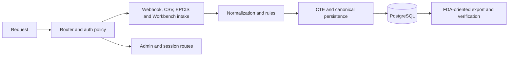

# C4 components: consolidated backend

This diagram is a simplified map of code paths; it does not imply that every
request traverses every component, or that all routers are release-enabled.

| Area | Source |
| --- | --- |
| Composition and route policy | [`server/main.py`](../../server/main.py), [`server/router_policy.py`](../../server/router_policy.py) |
| Webhook intake | [`webhook_router_v2/`](../../services/ingestion/app/webhook_router_v2/); requires authorization, idempotency and, in strict runtimes, configured HMAC verification. |
| Other intake | [`csv_templates.py`](../../services/ingestion/app/csv_templates.py), [`epcis/`](../../services/ingestion/app/epcis/), [`inflow_workbench.py`](../../services/ingestion/app/inflow_workbench.py) |
| Rules and persistence | [`rules/`](../../services/shared/rules/), [`cte_persistence/`](../../services/shared/cte_persistence/), [`canonical_persistence/`](../../services/shared/canonical_persistence/) |
| Exports | [`fda_export/`](../../services/ingestion/app/fda_export/) |
| Admin and sessions | [`services/admin/app/`](../../services/admin/app/), [`services/shared/auth.py`](../../services/shared/auth.py) |
| Background tasks | [`task_processor.py`](../../server/workers/task_processor.py), [`task_queue.py`](../../services/shared/task_queue.py), [`embedded_scheduler.py`](../../server/workers/embedded_scheduler.py) |

Canonical and legacy persistence paths coexist; see the
[persistence cutover](../persistence/dual-write-cutover.md). Enforcement and
availability depend on the route and configuration. Graph and NLP code is
excluded from the checked-in production allowlist; its existence is not evidence
that graph-backed functionality is available in a deployed environment.
