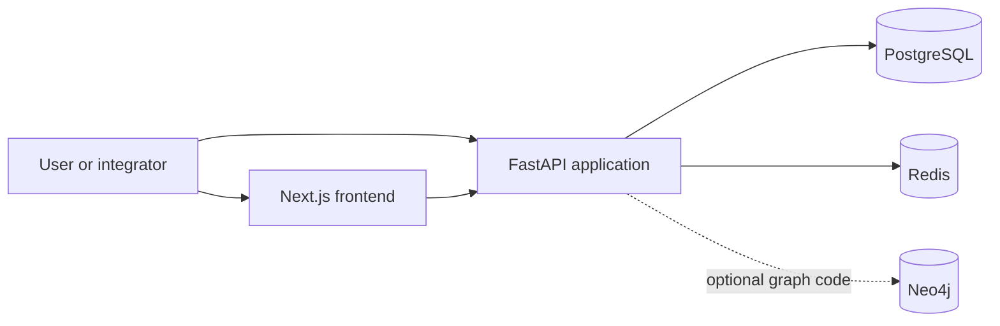

# C4 containers: checked-in topology

The repository configures one consolidated FastAPI backend and a separate Next.js
frontend. This diagram is a build and code view, not verification of the live
topology or service health.

| Component | Evidence and role |
| --- | --- |
| Frontend | [`frontend/`](../../frontend/) contains the Next.js app. |
| Backend | [`railway.toml`](../../railway.toml) selects the root [`Dockerfile`](../../Dockerfile); its command runs migrations and starts `server.main:app` with Gunicorn/Uvicorn workers. |
| PostgreSQL | Persists application data; Alembic migrations are in [`alembic/versions/`](../../alembic/versions/). |
| Redis | Supports sessions and runtime controls. The dev compose file starts Redis with PostgreSQL. Strict runtimes require Redis for readiness and protected paths. |
| Neo4j | Graph integration exists, but graph routes are excluded from the checked-in production allowlist. |

The `services/` directories organize code; they do not by themselves prove
separate deployments. Legacy compose, gateway and Kafka-compatible code may
represent other topologies. Consult [consolidation](CONSOLIDATION.md) and
[router policy](../../server/router_policy.py) before relying on them.
