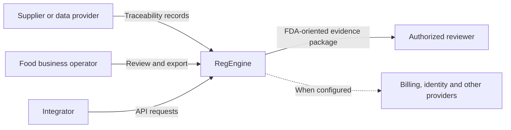

# C4 context: FSMA traceability

This is a source-level view of the intended product workflow, not a claim about
live deployment, certification, or customer adoption. See the
[product description](../PRODUCT_DESCRIPTION.md) for capability boundaries.

The checked-in application supports webhook, CSV and EPCIS intake, validation,
evidence persistence, and FDA-oriented exports through different paths. Some
capabilities depend on configuration and router policy. An export or a verified
hash does not establish source-data accuracy or FDA approval. Operators should
verify a real request, its authorization and applicable evidence requirements in
the target environment.
