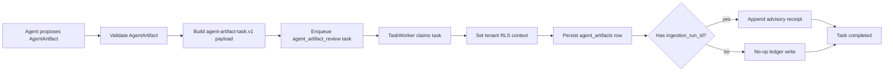

# Agent Ledger Bridge

Version: `agent-artifact-task.v1`

The bridge operationalizes the advisory agent contract without allowing agents
to mutate canonical evidence. Agents emit `AgentArtifact`; the bridge validates
that artifact, enqueues a durable tenant-scoped task, and records an advisory
receipt on the ingestion-run ledger when the artifact includes
`context.ingestion_run_id`.

## Flow

## Contract Rules

- Source of truth: `services/shared/agent_task_bridge.py`.
- Queue task type: `agent_artifact_review`.
- Queue payload version: `agent-artifact-task.v1`.
- The payload embeds the full `AgentArtifact` and repeats the traceability
  fields needed by queue operators:
  `evidence_ids`, `canonical_event_ids`, `ingestion_run_id`, `source_hashes`,
  `rule_id`, `rule_version`, `citation_reference`, and `request_id`.
- Repeated fields must match the embedded artifact exactly.
- Queue idempotency key:
  `agent_artifact_review:{tenant_id}:{artifact_id}:agent-artifact.v1`.
- Task rows are tenant-scoped and use the shared queue retry, DLQ, replay, and
  metrics behavior.
- The worker applies the tenant RLS context before touching the ledger.
- The worker persists the validated artifact in `fsma.agent_artifacts` before
  recording ledger metadata.
- Redelivery is idempotent: the insert arbitrates on
  `ON CONFLICT (artifact_id, tenant_id)` and a task whose artifact is already
  recorded appends no second receipt (`skip_reason='artifact_already_recorded'`).
  An `artifact_id` that belongs to another tenant fails on the primary key
  instead of being dropped silently.
- Ledger receipts are advisory only. They do not apply the suggestion, alter
  canonical events, mutate evidence attachments, or change export artifacts.

## Persistence

`fsma.agent_artifacts` stores the immutable advisory artifact envelope and
flattened traceability fields used by the operator review queue. The database
computes `artifact_hash`, validates source hashes and traceability anchors, and
rejects updates/deletes.

`fsma.agent_artifact_reviews` stores one tenant-scoped operator decision per
artifact. Terminal decisions (`accepted`, `rejected`, `needs_more_evidence`)
require `reviewed_by` and `reviewed_at`; pending rows must not provide them.
The table links back to `fsma.agent_artifacts`, `fsma.ingestion_runs`, and
`fsma.ingestion_run_receipts` through composite tenant-safe foreign keys.

## Ledger Behavior

When `ingestion_run_id` is present, the worker appends one
`fsma.ingestion_run_receipts` row:

- `state='needs_review'` when `requires_human_review=true`
- `state='rule_evaluated'` when `requires_human_review=false`
- `actor='agent:{agent_name}'`
- `request_id` copied from artifact context when present
- `metadata` contains the artifact identity, confidence, suggestion,
  traceability anchors, task version, task type, and typed payload

When `ingestion_run_id` is absent, the worker completes the task without a
ledger write. The artifact remains advisory and traceable through its other
anchors, but the run ledger is not modified because there is no run to attach
to.

## Schema

Non-Python consumers should validate bridge payloads against
`data-schemas/events/agent.task.schema.json`.
