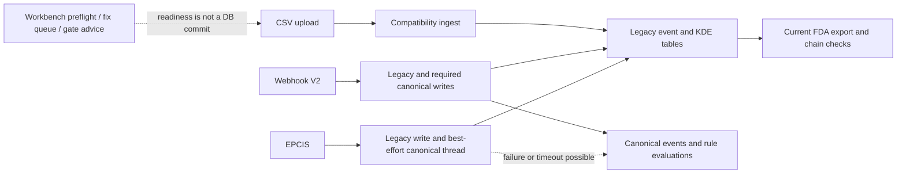

# Operation Deep Market Lab — RegEngine

**Decision: MODIFY. Continue a bounded operator-workflow experiment; pause broad launch and unqualified proof/compliance claims.** The repository contains substantial working implementation, but several evidence contracts fail controlled checks. The market is already served by credible alternatives, and no paid or retained customer demand was verified. Neither “accelerate” nor “kill the whole concept” is supported by this evidence.

**Best next move:** observe one authorized operator's current CSV/reconciliation task, compare a bounded assisted service with the product, and measure all human work. In parallel, repair only the artifact/evidence contracts needed by that exact pilot path. Discovery does not need to wait for the entire audit backlog; trusted hosted evidence use does need the selected path's safety gates.

Date: **August 31, 2026**. Inspected base: `41aa11c5071713c45521b7772c11b5a5cc9872c8`, branch `main`. Classification: **docs-only research plus experimental offline simulation/probes**. No application code, API, schema, auth, billing or deployment configuration changed. No deployment, outbound customer message, purchase, production credential access or recurring automation occurred. This is the completed bounded research run, not a claim that all external unknowns have been resolved.

## Read this package

| Decision area | Evidence |
|---|---|
| Current mechanism and failures | [Engineering/QA](engineering.md), [security](security.md), [scaling](scaling.md) |
| Current rule and real alternatives | [Regulation](regulation.md), [market](market.md) |
| Operator workflow and distribution | [Product/design](product.md), [independent judgment](adjudication.md) |
| Contribution, capacity and survival | [Economics](economics.md), [inputs](economics_inputs.json), [results](economics_results.json), [independent math review](math_review.md) |
| Reproduced counterexamples and regressions | [Replication report](replication.md), [chain/transaction probe](replication_probe.py), [chain/transaction results](replication_results.json), [historical export probe](export_verification_probe.py), [baseline export results](export_verification_results.json), [post-integration export results](export_verification_results_integrated.json) |
| Research memory and handoff | [20 assumptions](assumptions.csv), [claim-evidence graph](claims.md), [next ten experiments](experiments.md), [related worktree evidence](related-work.md) |

Eight specialist agents handled six independent research lanes, two technical/math replication lanes, and a second-wave independent judgment. The root handled current-state synthesis and the economics implementation. Roles were the repo's `planner` and `security_review`, with bounded research implementation by the root. A nominal council of dozens of overlapping agents would not have added evidence. Agent agreement was never counted as customer validation.

## Current-state map

The actual checkout is the production application repository; the guide's generic `repo/` description was not treated as a literal subdirectory. Root `CURRENT_SYSTEM_MAP.md` is absent; its archived version explicitly describes an obsolete deployment. Current code, README, ownership documents and Docker/server wiring were inspected instead. The legacy MVP spec's regulatory/Neo4j/Kafka statements were not promoted over current code or primary sources.

This diagram is a deliberately narrow code map, not a deployed topology or exhaustive route inventory. [Engineering](engineering.md) traces the exact handlers. The recommended architecture remains the consolidated FastAPI backend plus PostgreSQL and existing frontend. Preserve tenant context and transactional evidence. Do not add microservices, generic AI agents, another ledger or new dependencies to address these scoped contracts. Canonical/legacy retirement needs reconciliation, not an immediate schema rewrite.

## Strongest evidence and counterevidence

| Finding | Evidence boundary | Decision |
|---|---|---|
| Selected auth, ingestion and frontend components have substantial passing tests | Local unit/component tests, not live operation | Retain the working foundation; do not rewrite wholesale |
| Stored-chain verification approves mutated quantity/KDE content | Two independent SQLite probes using real verifier, with a corrupted-chain negative control | Define and repair content-versus-chain assurance before promising unchanged evidence; not a demonstrated remote exploit |
| At base `41aa11c5`, historical verification rejected unredacted output and full-export producer labels; the integrated probe now accepts both privacy modes and both full-export labels | Real CSV generator/handler with synthetic DB reads; immutable historical membership remains untested | Keep the regression and test late-arriving data against retained membership before trusted historical claims |
| EPCIS may acknowledge legacy persistence after canonical failure; retry skips repair | Existing component tests and independent source inspection | Durable acceptance on the exact pilot intake path is a release gate |
| Public pricing, backend plans and old pilot terms disagree | Static offer/checkout trace; actual Stripe charges unknown | Reconcile one offer before a price experiment or charge |
| Competitors already provide CSV, validation and traceability workflows | Primary vendor publications, not hands-on performance comparisons | “Cheap CSV export” and “unserved importer” are weak wedges; test measurable reconciliation improvement |
| Free access and support can consume cash despite positive unit contribution | Reproducible hypothetical model, not actual finances | Measure labor, constrain delivery scope, and preserve existing commitments |

Additional bounded findings include quantity/UoM idempotency collisions, export selection limits, misleading regulatory citations/coverage language, default redaction versus submission completeness, actor-audit deduplication, and optional graph publication at a nested commit. The graph feature defaults off; keep it off unless a real workflow needs it. Severity of an assurance gap must not be confused with proof of deployed exploitation.

The related task independently found that packages generated at base `41aa11c5` were incompatible with the public SDK. The integrated generator now emits the SDK's `path` and Merkle contract. Local API/SDK checks accept declared `VERIFIED` and `PARTIAL` packages and reject byte tampering, a self-consistent `UNVERIFIED` chain, manifest/hashed-chain disagreement, and undeclared or duplicate ZIP members. The verifiers do not independently recompute the persisted chain, authenticate the issuer, or prove source-data accuracy. [Related work](related-work.md) preserves the baseline and integration boundary.

## Thesis evolution and competing alternatives

**V0 — repository proposition:** an ERP-adjacent evidence layer converts supplier records to traceability artifacts. It is an implemented concept, not verified demand.

**V1 — surviving hypothesis:** a narrowly selected operator pays to resolve recurring supplier-data exceptions and complete an independently understandable request/drill, with explicit provenance limits, service scope and measured assistance. Evidence responsible: workflow overlap with incumbents, uncertain purchase triggers, divergent persistence/export guarantees and unknown service effort. Expected improvement: a testable outcome with fewer unsupported promises. New risks: founder labor becomes the product; counterparties may not cooperate; a periodic drill may not support a subscription. Required tests: E01/E02/E10 in the backlog, plus chosen-route safety gates before hosted evidence reliance.

**Co-equal alternative:** sell only a bounded assisted reconciliation/rehearsal if that is what buyers value. That would be a services result, not automatic validation of recurring SaaS. API/integrator distribution waits for repeatable demand; consumer/gamified, marketplace, cross-regulatory platform and speculative data-product expansion are deferred. No product direction, price or canonical description was changed by this research.

The [independent adjudicator](adjudication.md) agrees with MODIFY but rejects indefinite continuation. A fixed resource cap can justify PAUSE without claiming the market rejected the product. If only a service sells, judge its margins honestly. If a naturally infrequent task produces value, do not force weekly usage as a proxy for retention.

## Quantitative result worth testing

Under the illustrative base inputs, $499/month less payment fees, processing, direct service, four support hours valued at $50/hour and risk allowance leaves **$205.74 service contribution, or 41.2%**. After the assumed acquisition/onboarding allocation it leaves **$72.40**. The same non-support costs allow only **1.13 support hours/month** for a 70% service margin. Actual cost and accepted price are unknown.

The seeded model executes 10,000 account draws and 10,000 paired 24-month paths for each free-service term. Its 12-month-free path needs far more hypothetical capital than its two-month-free path. These are sensitivity results under invented conversion/churn/cost assumptions, **not business survival probabilities**. Mean, median, variance, percentiles, adverse tails, first shortfalls and censoring are retained. [Economics](economics.md) states the full assumptions and exclusions; [math QA](math_review.md) independently checks the arithmetic and boundary behavior.

## Time, scale, outliers and missing questions

| Horizon or shock | Question that matters | Smallest next evidence |
|---|---|---|
| Day 1 | Is there a real task and authority to share its input? | Current-process observation, no hosted proof promise |
| Day 7 | Is work actually reduced or merely shifted to the founder/supplier? | Separate operator, founder and waiting-time ledger |
| Day 30 | Do corrections and a later request preserve history? | Amendment/re-export/artifact membership check |
| Day 90 | Does the task recur at its natural cadence? | A new source batch/drill and another operator |
| Year 1 | Is retained evidence still recoverable after churn or outage? | Restore and cancellation-custody test |
| Year 3 | Can operations function without founder memory? | Independent operator reconstruction from retained procedures/artifacts |
| Zero adoption or longer non-enforcement period | Can recurring value justify spending now? | Buyer-specific trigger; stop at resource cap |
| Large tenant or simultaneous recalls | Do hot-tenant locks, history scans and support congestion overwhelm averages? | Bounded concentrated load plus incident tabletop |
| Incumbent imitation or lower compute price | Does anyone still pay for the difference? | Compare actual alternatives on measured reconciliation outcome |
| Missing or false supplier data | Can any score/hash establish that absent records existed or statements were true? | Known source-set reconciliation and provenance review; cryptography alone cannot |

The scale review models 10 through 1,000,000 events/day. One million/day averages 11.57 events/second, but 10× bursts and full retained history change the problem. At assumed 8 KiB/event, two years is about 5,569 GiB before backups. Those are arithmetic scenarios, not load-tested capacity. Per-account support makes 100/1,000/10,000 paying customers separate organizational problems; the product memo makes the staffing assumptions explicit.

Unknowns include recipient acceptance, exemption profile, source authenticity/completeness, real customer status outside this checkout, supplier incentives, natural recurrence, available cash, paid conversion, actual bills, support burden, deployed RLS/trigger state and recovery performance. No patent clearance, legal certification, TAM validation or actual customer experiment was completed.

## Verification and failures retained

Counts are **per executed selection and overlap**; do not add them into a unique suite total.

| Selection | Result | Limit |
|---|---|---|
| Engineering shared and ingestion selections | 143 passed | In-process tests with network disabled; no real PostgreSQL |
| Security selections | 248 passed, 9 failed | Five missing old migration-path assertions, four stale `SET LOCAL` assertions; not demonstrated RLS failures |
| Replication nearby regression tests | 24 passed | Overlaps engineering; both new counterexamples still reproduce |
| Inflow frontend selections | 31 passed across 3 files | Component tests; no browser/deployed flow |
| Frontend promise audit | Passed | Copy linter does not prove promises are true |
| Independent economics checks | 13 passed | Synthetic arithmetic, boundaries and regeneration only |
| Integrated package-verifier regression | 21 passed | Local API/SDK contract, generic-bundle compatibility, and negative cases; no trusted root, issuer authentication, or independent persisted-chain recomputation |
| Standalone integrity probe | Stored-content blind spot and valid corrupted-chain control still reproduce | SQLite and synthetic state; not a demonstrated production mutation path |
| Historical export baseline / integrated probe | Baseline defects retained; current probe passes both privacy modes and both full-export labels, and confirms two intentional 409 cases | Synthetic patched reads; no immutable late-arrival snapshot or real database |

Exact commands and outputs are in each lane report. The original run reran the simulation, all 13 math checks and both probes; those baseline JSON outputs remain retained. After integration, the historical export probe was updated and passed for the repaired mode/type contract while preserving fail-closed handling for audit rows without a recorded privacy mode and recall rows with incomplete filters. All four research Python files passed syntax parsing and Ruff's `E9,F63,F7,F82` checks. The artifact check passed for all 14 Markdown files, 142 local repository links including the integrated evidence-wave targets, five JSON files, and all 20 unique assumption IDs with correctly calculated scores; whitespace checks passed. Import-time diagnostic logging in the export probe goes to stderr so saved stdout is valid JSON. Full backend/frontend suites, repo-wide type/lint, live infrastructure, load, restore, payment, third-party product trials and customer usability were not run in this scoped research task. Infrastructure availability was not exhaustively tested and is not claimed as a hard blocker. No failing existing test was weakened or removed.

## Next ten actions and resource allocation

The [experiment backlog](experiments.md) gives each action a hypothesis, information value, cost/time, dependencies, pass/fail condition, current result, confidence update and next decision:

1. Observe a real buyer's existing task and source-sharing authority (E01).
2. Compare measured delivery cost and a bounded service/product offer (E02).
3. Reconcile the public offer, checkout interval/price and entitlement (E03).
4. Maintain the repaired package contract and resolve the remaining content/authenticity limits without overstating what hash consistency proves (E04).
5. Prove selected-route durable acceptance, retries, corrections and two-tenant isolation in PostgreSQL (E05).
6. Review the operator's actual regulatory obligations and exported fields (E06).
7. Reconcile full export membership, history, privacy mode and actor records (E07).
8. Demonstrate restoration and custody through provider/billing disruption (E08).
9. Measure only the supported traffic/history envelope after correctness (E09).
10. Repeat the outcome with another operator at the natural cadence; choose subscription, service or pause from behavior (E10).

Recommended allocation: ten founder hours over fourteen days, no ad spend; one implementer plus one reviewer on a selected evidence contract, then one disposable-database experiment. Do not fund broader feature development, mass outreach or a new simulation wave before actual input changes the decision. Additional resources should be tied to a named decision: a consented file/session, a qualified field review or a disposable DB. Their real availability/cost remains unknown.

**Decision thresholds:** CONTINUE after an observed useful outcome and chosen-route evidence gates; ACCELERATE only after independent repeated paid outcomes, acceptable measured cost and verified operating controls. MODIFY or service-test if value exists but software/recurrence assumptions fail. PAUSE at the resource cap without new evidence. KILL the specific offer when credible buyers' current alternatives repeatedly dominate it and no bounded viable outcome remains; lack of records in this repo alone does not prove that verdict.

Files changed: this research directory only. What changed: evidence, models, reproducible probes and decision memory, plus a post-integration contract update. Tests run/passed/failed: scoped selections above. Not tested and remaining risks: explicitly preserved. Recommended next step: one authorized current-process observation alongside the next unresolved evidence gate: historical membership and two-tenant PostgreSQL behavior, while keeping the package-contract regression.
